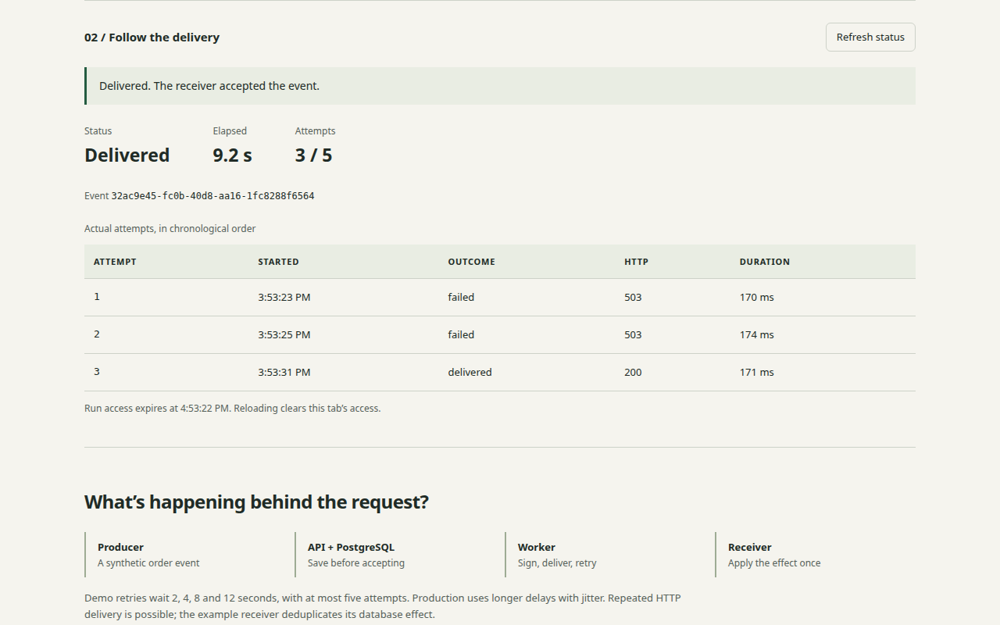
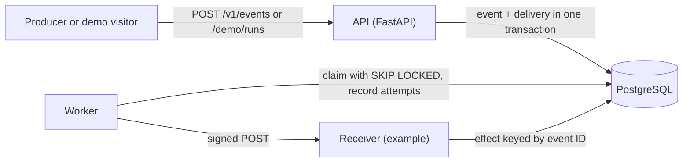
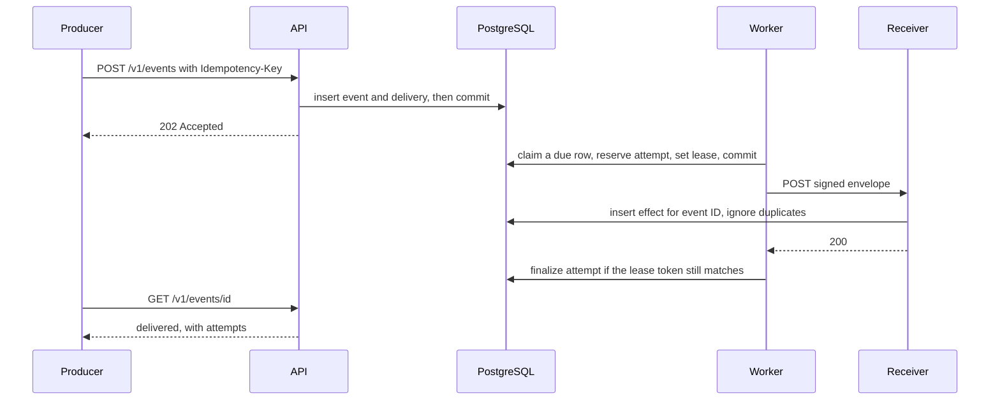

# Webhook Relay

A small Python service that accepts business events through an authenticated API, stores them in
PostgreSQL before acknowledging them, and delivers them to one configured HTTP receiver through a
separate worker. Failed deliveries are retried a bounded number of times, crashed workers are
recovered through leases, and every attempt is recorded and inspectable.

It simulates a fictional order application notifying a fulfillment service of an `order.created`
event: one team produces the event, this service owns reliable delivery, and the receiving team owns
the resulting business action. It is a portfolio project: no enterprise usage and no throughput
numbers are claimed.

**Live demo:** coming soon. The public instance is not online yet; until it is, run the stack locally
with the three commands in the [Quickstart](#quickstart).

[](https://github.com/PaulinhoEletron/webhook-relay/actions/workflows/ci.yml)



## Architecture



One delivery, end to end:



1. The API validates the request, then inserts the event and its delivery row in **one transaction**.
   It answers `202` only after the commit. A unique `(scope_id, idempotency_key)` constraint
   arbitrates duplicates, including concurrent ones.
2. The worker claims one due delivery with `FOR UPDATE SKIP LOCKED`, reserves the attempt number, sets a
   lease token and expiry, and commits **before** it makes the HTTP call. No database transaction is
   held open during HTTP.
3. It sends the stored, immutable JSON bytes with an HMAC-SHA256 signature computed fresh for each
   attempt. The response body is never read.
4. Finalization updates the attempt and the delivery in one transaction, conditional on the lease token
   and on the lease not having expired. A stale worker cannot overwrite newer state.
5. The example receiver verifies the signature and a five-minute timestamp window, then inserts its
   business effect keyed by the stable event ID. Duplicate receipts return `200` without repeating it.

Design decisions are recorded in [docs/architecture.md](docs/architecture.md) and the ADRs:

- [0001 PostgreSQL as the queue](docs/adr/0001-postgres-as-queue.md)
- [0002 Lease fencing and recovery](docs/adr/0002-lease-fencing-and-recovery.md)
- [0003 Idempotency by unique constraint](docs/adr/0003-idempotency-by-unique-constraint.md)
- [0004 At-least-once delivery with receiver deduplication](docs/adr/0004-at-least-once-with-receiver-dedup.md)

## Quickstart

Requires Docker with Compose, Make and Python 3 (only to generate the local secrets).

```sh
make init   # creates a private .env with random local secrets; an existing file is left unchanged
make up     # builds the image, migrates, starts db, receiver, api and worker, waits until healthy
make demo   # sends one synthetic order and prints its real delivery history
```

Then open the [delivery lab](http://localhost:8000/) or the interactive [API docs](http://localhost:8000/docs).

```sh
make down    # stop the containers, keep the data
make clean   # stop the containers and DELETE the database volume
```

Only the API is published, on `127.0.0.1:8000`. PostgreSQL, the receiver and the metrics listeners are
reachable only inside the Compose network. Never share `.env`: it holds the operator key.

## Demo walkthrough

Open http://localhost:8000/ and start each scenario. Every click creates an independent run with a
synthetic order; the page shows the event ID, elapsed time and the attempts recorded by the worker, and
polls every two seconds until the run finishes or two minutes pass (**Refresh status** fetches again).

1. **Successful delivery.** The receiver answers `200`. One attempt, status `delivered`.
2. **Retry & recover.** The receiver answers `503`, `503`, then `200`. Three attempts, waiting 2 s and
   4 s in between (the accelerated demo schedule), status `delivered`. Failed attempts stay `failed` in the
   history even though the delivery later succeeds.
3. **Permanent failure.** The receiver answers `400`. One attempt, status `failed`: client errors other
   than 408 and 429 are not retried.

The statuses come from the worker's recorded HTTP attempts, not from a script. To drive the real
operator API instead, send an event yourself (the key is read from `.env` without printing it):

```sh
KEY=$(grep '^OPERATOR_API_KEY=' .env | cut -d= -f2)
curl -s -X POST http://localhost:8000/v1/events \
  -H "X-API-Key: $KEY" -H "Idempotency-Key: order-demo-001" -H "Content-Type: application/json" \
  -d '{"event_type":"order.created","data":{"order_id":"demo-order-001","amount_minor":12990,"currency":"BRL"}}'
```

Repeating the same command returns `200` with `Idempotency-Replayed: true` and the same event ID.

## API contract

Interactive documentation is served at `/docs`; the schema is at `/openapi.json`. Timestamps are UTC.

### Operator API

All `/v1/*` endpoints require `X-API-Key`.

| Method | Path | Purpose | Success |
| --- | --- | --- | --- |
| `POST` | `/v1/events` | Accept an event. Requires `Idempotency-Key` (printable ASCII, 1-128 chars). | `202`, or `200` on an idempotent replay |
| `GET` | `/v1/events/{event_id}` | Delivery status, attempts used, last error code | `200` |
| `GET` | `/v1/events/{event_id}/attempts` | Ordered attempt history | `200` |
| `GET` | `/health/live` | Process liveness | `200` |
| `GET` | `/health/ready` | Database reachable and migration revision current | `200`, or `503` |
| `GET` | `/health/worker` | `online` when the worker heartbeat is under 30 s old | `200` |

Request body for `POST /v1/events`: `event_type` (string, 1-100 chars) and `data` (JSON object). Unknown
top-level fields and non-finite numbers are rejected. The body is limited to 16 KiB, enforced while
streaming as well as from `Content-Length`. A `202` returns `event_id`, `status`, `status_url` and
`created_at`, plus a matching `Location` header.

Idempotency: the same key with the same validated content returns the existing event (`200`,
`Idempotency-Replayed: true`) and enqueues nothing new; the same key with different content returns `409`
and leaves the original untouched. Operator events and their keys are kept until explicitly removed.

### Sandbox API (public demo)

Enabled by `DEMO_MODE=true`; answers `404` otherwise.

| Method | Path | Purpose | Success |
| --- | --- | --- | --- |
| `POST` | `/demo/runs` | Body `{"scenario": "success" \| "temporary_failure" \| "permanent_failure"}`. Returns `run_id`, `event_id`, `status_url`, `expires_at` and a one-time `read_token`. | `202` |
| `GET` | `/demo/runs/{run_id}` | Run status and sanitized attempts. Requires `Authorization: Bearer <read_token>`. | `200` |

Callers choose only the scenario; payload, destination, headers and retry schedule come from server
configuration. Tokens are stored as SHA-256 hashes, expire after one hour and never belong in URLs. There is
no listing endpoint, so runs cannot be enumerated. Limits are described in [docs/sandbox.md](docs/sandbox.md).

### Errors

Errors share one JSON shape, with no stack traces, SQL or secrets:

```json
{"error": {"code": "idempotency_conflict", "message": "Key already used for a different request", "request_id": "<uuid>"}}
```

| Status | `code` | When |
| --- | --- | --- |
| 401 | `unauthorized` | Missing or wrong `X-API-Key`; missing, wrong or expired demo token |
| 404 | `not_found` | Unknown event, or demo endpoints with `DEMO_MODE=false` (unknown paths answer `404` with code `http_error`) |
| 405 | `http_error` | Method not allowed on a path |
| 408 | `request_timeout` | Request body not received within `BODY_READ_TIMEOUT` |
| 409 | `idempotency_conflict` | Idempotency key reused with different content |
| 413 | `body_too_large` | Body over 16 KiB |
| 422 | `invalid_request` | Validation failure (bad fields, header, `Content-Length`) |
| 429 | `quota_exceeded` | Sandbox limit reached; `Retry-After` says when to retry |
| 503 | `service_unavailable` | Database unavailable or migrations not current |

Every response carries an `X-Request-ID` header, which matches `request_id` in error bodies and in the logs.

### Outgoing request

The worker `POST`s the stored JSON envelope (`id`, `type`, `created_at`, `data`) with these headers:

| Header | Value |
| --- | --- |
| `X-Webhook-Id` | The stable event UUID |
| `X-Webhook-Attempt` | Attempt number (1-5) |
| `X-Webhook-Timestamp` | Unix timestamp of this attempt |
| `X-Webhook-Signature` | `v1=` plus the hex HMAC-SHA256 of `timestamp + "." + raw body` with `SIGNING_SECRET` |

Receivers should verify the signature in constant time, reject timestamps outside a five-minute window, and
deduplicate by `X-Webhook-Id`. [receiver/main.py](receiver/main.py) is a working example.

## Delivery guarantees

**Bounded at-least-once.** An accepted event is durable. The worker tries to deliver it up to five times and
then marks it `failed`; nothing guarantees eventual delivery after the budget is spent, and a `failed` event
is not re-queued by the service.

**Exactly-once HTTP delivery is not claimed and cannot be.** If the receiver processes a request and the
response is lost (timeout, connection reset, worker crash), the worker cannot know and will send it again.
Duplicate receipts are therefore possible. The example receiver makes the business effect happen once: its
`fulfillment_effects` row is keyed by the event ID with a primary-key constraint, and the effect and the
deduplication are the same insert. This demonstrates a database-backed effect, not deduplication of
arbitrary external actions such as email or payments. See
[ADR 0004](docs/adr/0004-at-least-once-with-receiver-dedup.md).

Retry policy (at most five reserved attempts, including the first):

| Result of an attempt | Action |
| --- | --- |
| HTTP 2xx | `delivered` |
| Connection error, timeout, HTTP 408, 429 or 5xx | Retry, if attempts remain |
| Any other non-2xx, including redirects (not followed) | `failed` immediately |
| Lease expired (worker crashed or lost the database) | Attempt marked `unknown`, retried if attempts remain |

| After failed attempt | Production delay | Demo delay |
| --- | --- | --- |
| 1 | 5 s | 2 s |
| 2 | 15 s | 4 s |
| 3 | 45 s | 8 s |
| 4 | 120 s | 12 s |

Production delays get up to 20% positive jitter; demo delays have none. A valid `Retry-After` (seconds or an
HTTP date) on a `429` or `503` raises the delay to at least that value, capped at 15 minutes. Each attempt has
a 3 s connect timeout and a 10 s overall deadline. Demo runs always use the accelerated schedule; operator
events use `RETRY_PROFILE` (default `production`). On `SIGTERM` the worker stops claiming and lets the
bounded in-flight request finish; anything interrupted is recovered when its lease expires (60 s by default).

## Public-demo safeguards

The sandbox is meant to be exposed from one small machine, so abuse limits live in the application and are
enforced in PostgreSQL, where they hold across processes and restarts. Details are in
[docs/sandbox.md](docs/sandbox.md).

| Safeguard | Behaviour |
| --- | --- |
| Creation quotas | 5 per client and 30 globally per rolling minute, 1,000 per UTC day; `429` with `Retry-After` |
| Active cap | At most 100 pending, processing or retry-waiting demo deliveries |
| Storage cap | New demo runs stop when the database reaches `DEMO_STORAGE_LIMIT_BYTES` (256 MiB by default) |
| Polling limit | 60 status reads per client and 600 globally per UTC minute |
| No visitor-controlled input | Only a scenario enum is accepted: no URLs, headers or payloads |
| Run isolation | Per-run bearer token (hashed at rest, one hour); no listing endpoint |
| Client identity | TCP peer by default; `CF-Connecting-IP` only with `TRUST_CF_CONNECTING_IP=true`; `X-Forwarded-For` never; IPv6 keyed by /64; stored as HMAC digests |
| Body limits | 16 KiB cap while streaming; `408` if the body takes longer than `BODY_READ_TIMEOUT`; Uvicorn keep-alive 5 s and concurrency limit 64 |
| Security headers | CSP, `nosniff`, `X-Frame-Options: DENY`, `Referrer-Policy`, `Permissions-Policy`, COOP/CORP on every response; `no-store` on `/v1`, `/demo` and `/health` |
| Metrics | Prometheus metrics on separate internal ports; `/metrics` on the public port is `404` |
| Retention | The worker deletes terminal demo runs 24 hours after their token expired, together with their idempotency keys and receiver effects |
| Containers | Non-root, read-only root filesystem, all capabilities dropped, `no-new-privileges`, memory/CPU/PID limits; only the API is published, on loopback |

These are application-level workload limits, not network-level denial-of-service protection.

## Tests and CI

```sh
uv sync --frozen        # once, installs the pinned dev tools
make lint               # ruff check + ruff format --check
make test               # isolated PostgreSQL (relay_test) in Docker: migrations, alembic check, pytest
make e2e                # full scenario run against the stack: delivery, replay, conflict, three
                        # demo scenarios, 401/413/404 checks, restart of api, worker and db
make test-browser       # Playwright against the running stack (npm ci, headless Chromium)
```

- `make test` currently runs 147 tests. They use real PostgreSQL, never SQLite, because they verify
  locking and constraints: duplicate ingestion, two workers claiming, expired and stale leases, crash
  recovery with killed subprocesses, receiver deduplication and sandbox quotas.
- `make test-browser` uses `PLAYWRIGHT_CHROMIUM_EXECUTABLE` if set; otherwise run
  `npx playwright install chromium` once. The browser and e2e runs create real demo runs, so wait 60 seconds
  between them to stay within the creation quota.
- The [GitHub Actions workflow](.github/workflows/ci.yml) runs on every push and pull request: ruff, the
  test suite on a pinned PostgreSQL 16 service (`alembic upgrade head`, `alembic check`, `pytest`), a
  migration round trip (`downgrade base`, `upgrade head`), gitleaks, `pip-audit`, `npm audit`, a runtime
  image build with a Trivy scan, and `make e2e` on the runner. Actions are pinned by commit SHA.

## Configuration

Set in `.env` (created by `make init` from [.env.example](.env.example)). The application validates secrets and
unsafe combinations at startup and refuses to start on placeholder secrets.

| Variable | Default | Meaning |
| --- | --- | --- |
| `POSTGRES_PASSWORD` | generated by `make init` | Database password for Compose. Read by Compose only, not by the application; must match `DATABASE_URL` and the existing volume. |
| `DATABASE_URL` | generated by `make init` | `postgresql+psycopg://` URL of the database. Required. |
| `OPERATOR_API_KEY` | generated by `make init` | Key for `/v1/*`, at least 32 characters. Required. |
| `SIGNING_SECRET` | generated by `make init` | HMAC key for outgoing signatures, at least 32 characters. Also keys the hashed client identities. Required. |
| `DESTINATION_URL` | `http://receiver:8001/webhooks` | Where events are delivered. Must be `https` with a host and no credentials, except the bundled Compose receiver URL in demo mode. |
| `DEMO_MODE` | `true` | Enables the delivery lab page and `/demo/*` endpoints, and the Compose receiver exception. |
| `RETRY_PROFILE` | `production` | `production` (5/15/45/120 s with jitter) or `demo` (2/4/8/12 s, requires `DEMO_MODE=true`). Demo runs are always accelerated. |
| `REQUEST_DEADLINE` | `10` | Overall seconds per delivery attempt; greater than 0 and at most 10. |
| `LEASE_DURATION` | `60` | Seconds a worker holds a claimed delivery before it can be recovered; minimum 60. |
| `PUBLIC_BASE_URL` | `http://localhost:8000` | Externally visible base URL of the API. Accepted and validated as a setting; the current code does not use it. |
| `DEMO_STORAGE_LIMIT_BYTES` | `268435456` | Total database size at which new demo runs are rejected (256 MiB). |
| `TRUST_CF_CONNECTING_IP` | `false` | Use `CF-Connecting-IP` for client identity. Enable only when the API is reachable exclusively through the Cloudflare tunnel. |
| `BODY_READ_TIMEOUT` | `10` | Seconds allowed to receive a request body before `408`; greater than 0 and at most 60. |
| `SOURCE_URL` | empty in code; the example file sets this repository's URL | `https` repository link shown on the page; empty hides the link. |
| `METRICS_PORT` | `9090` | Internal Prometheus listener of the API; `0` disables. Not published. |
| `WORKER_METRICS_PORT` | `9091` | Internal Prometheus listener of the worker; `0` disables. Not published. |

Variables used by tooling rather than the application: `RELAY_API_URL` (base URL for `examples/producer.py`,
`make e2e` and the browser tests, default `http://localhost:8000`), `PLAYWRIGHT_CHROMIUM_EXECUTABLE` (use an
installed Chromium for `make test-browser`), `E2E_READY_TIMEOUT` (seconds `make e2e` waits for readiness,
default 90).

## Operations

[docs/operations.md](docs/operations.md) is the runbook: where to find logs and metrics, symptom-check-fix
procedures for a stopped worker, a database outage, a failed destination, expired leases, stuck deliveries and
exhausted quotas, plus backup, restore, rollback, secret rotation and the measured idle memory footprint.

```sh
make backup                                        # pg_dump to backups/, newest 7 kept
make restore FILE=backups/relay-<timestamp>.dump   # replaces all data; asks first
make rollback VERSION=<git tag or commit>          # run an older version against the same data
```

## Known limitations

- **Not highly available.** One API process, one worker and one PostgreSQL container on a single machine.
  A public instance, when there is one, runs only while that machine and its tunnel are up.
- **One fixed destination.** No multiple destinations, subscriptions, accounts, billing, manual replay or
  cancellation. Arbitrary visitor URLs are deliberately not accepted.
- **No automatic re-queue.** An event that reached `failed` used its five attempts. Resubmit it with a new
  `Idempotency-Key`.
- **Duplicates are possible.** Receivers must deduplicate by event ID; see
  [Delivery guarantees](#delivery-guarantees).
- **The queue is PostgreSQL.** Polling about once a second suits this scale; it is not a high-throughput
  broker. See [ADR 0001](docs/adr/0001-postgres-as-queue.md).
- **Receiver deduplication is a demonstration.** It shares the relay's database for simplicity; a real
  receiver owns its own storage and effects.
- **Fixed-window demo limits** can allow a short burst at a window boundary.
- **No throughput or availability figures** are claimed; the only measurements are the idle memory numbers in
  the runbook.

## Security

To report a vulnerability privately, use "Report a vulnerability" on the repository's Security tab
(GitHub private security advisory) instead of opening a public issue.

## License

[MIT](LICENSE). See [CHANGELOG.md](CHANGELOG.md) for release notes.
