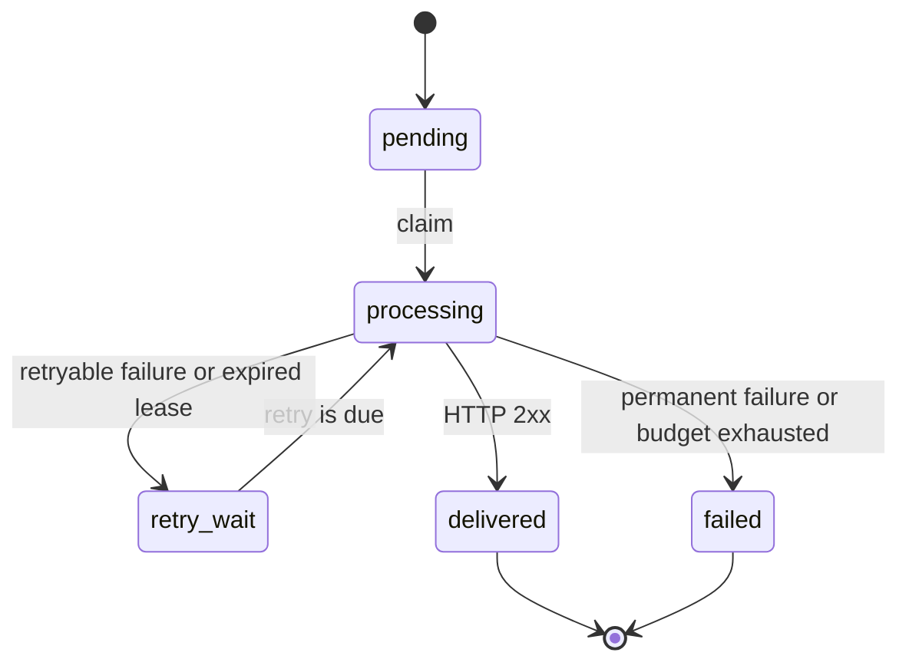

# Architecture

How the service is built and why. The [README](../README.md) has the quickstart and the API contract; the
decisions that are easiest to get wrong have their own records:

- [ADR 0001: PostgreSQL as the queue](adr/0001-postgres-as-queue.md)
- [ADR 0002: Lease fencing and recovery](adr/0002-lease-fencing-and-recovery.md)
- [ADR 0003: Idempotency by unique constraint](adr/0003-idempotency-by-unique-constraint.md)
- [ADR 0004: At-least-once delivery with receiver deduplication](adr/0004-at-least-once-with-receiver-dedup.md)

## Components

| Component | Role |
| --- | --- |
| API (`app/main.py`) | Authenticated ingestion, status and attempt inspection, the sandbox endpoints, health checks and the demo page. |
| Worker (`app/worker/`) | Claims due deliveries, sends signed HTTP requests, records attempts, schedules retries, recovers expired leases and cleans expired demo data. |
| Receiver (`receiver/`) | Example downstream service: verifies signatures and applies one business effect per event ID. It returns real HTTP responses, including the scripted failures of the demo scenarios. |
| PostgreSQL 16 | Source of truth for events, deliveries, attempts, receiver effects, demo runs, quotas and the worker heartbeat. |

The API, worker and receiver use one non-root, read-only image with different commands. A single
migration job (`alembic upgrade head`) must succeed before any of them starts, so migrations never run
concurrently. The database volume survives `make down`.

## Data model

| Table | Purpose and key constraints |
| --- | --- |
| `events` | One row per accepted event: scope, idempotency key, content fingerprint, and the immutable outbound body as bytes. Unique `(scope_id, idempotency_key)`. |
| `deliveries` | One row per event: `status`, `attempts_used` (0 to 5), `next_attempt_at`, `lease_token`, `lease_expires_at`, `last_error_code`. Indexed on `(status, next_attempt_at)` for due work. |
| `delivery_attempts` | One row per reserved attempt, unique `(event_id, attempt_number)`: outcome (`in_progress`, `delivered`, `failed`, `unknown`), HTTP status, duration. |
| `fulfillment_effects` | The example receiver's business effect, keyed by event ID, with no foreign key to relay data. |
| `demo_runs` | Sandbox runs: hashed read token, scenario, expiry, client key, receipt counter. |
| `demo_poll_buckets`, `worker_heartbeat` | Polling quota counters and worker liveness. |

## Accepting an event

- The request is validated, serialized deterministically (sorted keys, fixed separators, UTF-8, finite
  numbers) and fingerprinted with SHA-256. JSON numbers such as `1` and `1.0` stay distinct.
- The event and its delivery row are inserted in one transaction with
  `INSERT ... ON CONFLICT DO NOTHING` on the unique key. A concurrent identical request waits for the first
  transaction and then reads the committed winner. A different fingerprint under the same key is a `409`.
- The outbound envelope (`id`, `type`, `created_at`, `data`) is serialized once, at ingestion, and stored as
  bytes. Every attempt sends exactly these bytes.
- The API answers `202` only after the commit. A crash before the commit rolls everything back; after it,
  the pending event survives any API restart.
- Idempotency keys are printable ASCII, 1 to 128 characters, which excludes characters that are unsafe in
  HTTP headers and PostgreSQL text.

## Delivering an event

- **Claim.** In a short transaction the worker selects one due `pending` or `retry_wait` row with
  `FOR UPDATE SKIP LOCKED`, increments `attempts_used`, inserts the attempt row, assigns a fresh lease token
  and expiry, and commits. Two workers never hold a valid claim on the same delivery.
- **Send.** HTTP runs outside any transaction. HTTPX phase timeouts (3 s connect) are supplemented by an
  asyncio wall-clock deadline (10 s). Redirects are not followed, and the response body is streamed and
  discarded, never buffered or logged.
- **Finalize.** One transaction updates the attempt and the delivery, conditional on the lease token and an
  unexpired lease. A stale or replaced holder finds no row and changes nothing.
- **Recover.** Before each claim the worker recovers up to 100 expired `processing` rows under the same row
  locks: the interrupted attempt becomes `unknown` (and still counts), and the delivery is rescheduled or, if
  the fifth attempt was interrupted, `failed`.
- **Shutdown.** On `SIGTERM` the loop stops claiming and lets the bounded in-flight request finish. An abrupt
  exit leaves a durable lease for recovery. Database errors back the loop off up to 30 seconds.

The retry policy lives in `app/worker/retry.py`; time and jitter are parameters, so boundary tests are
deterministic while integration tests use real PostgreSQL and real HTTP responses.

## The receiver

The receiver verifies `X-Webhook-Signature` (HMAC-SHA256 over `timestamp + "." + body`, constant-time
comparison) and a five-minute timestamp window, checks the envelope against `X-Webhook-Id`, and inserts the
effect with `ON CONFLICT DO NOTHING` before answering `200`. Duplicates answer `200` without changing the
first effect. For demo runs it counts receipts per event in `demo_runs` under a row lock, so concurrent
visitors never share scenario state, and returns the scripted `503`/`400` responses.

Effects have no foreign key to relay events. This models downstream ownership and keeps deduplication intact
when relay data is deleted; the demo shares one database only for simplicity. No external side effect such as
email or payment is claimed to be atomic with the insert. See
[ADR 0004](adr/0004-at-least-once-with-receiver-dedup.md).

## Sandbox

The sandbox accepts only a scenario enum. Admission checks and the insert share a transaction and an advisory
lock, so quotas hold across processes and restarts. Limits, client identity, edge headers and retention are
described in [sandbox.md](sandbox.md).

## Observability

API, worker and receiver log one JSON object per line (request or event ID, attempt, outcome, duration); keys,
tokens, signatures and payloads are never logged. Prometheus metrics are served on separate internal ports and
are not published; the public port answers `404` for `/metrics`. Details are in [operations.md](operations.md).

## Deliberate omissions

No Redis, Kafka or other queue (a second datastore adds dual-write failure cases without a requirement), no
frontend framework (one static page), no multiple destinations, replay, cancellation or accounts. Running a
public instance means exposing only the API port, through a tunnel, from one machine; see the
[README](../README.md#known-limitations) for the resulting limits.

Implementation references: [PostgreSQL 16 row locking](https://www.postgresql.org/docs/16/sql-select.html),
[SQLAlchemy PostgreSQL ON CONFLICT](https://docs.sqlalchemy.org/en/20/dialects/postgresql.html#insert-on-conflict-upsert)
and [HTTPX timeouts](https://www.python-httpx.org/advanced/timeouts/).
